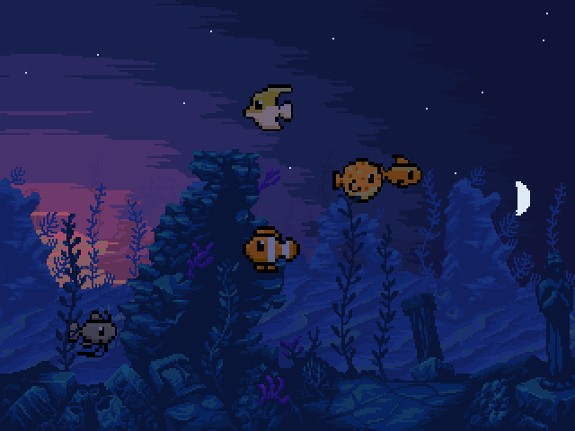
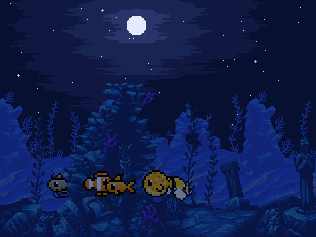
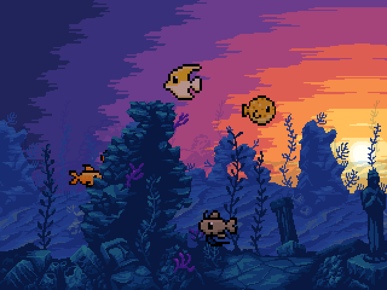

# deskfish

A fish tank for my desk. It runs on a small ESP32-S3 touchscreen board, and
each fish decides what to do next by asking a tiny language model that runs on
the board itself. No cloud, no phone app. Five fish, a tank, and a sky that matches
the real one outside.



That's a full day in 24 seconds, recorded from the desktop simulator with the
sky time-lapse on. The fish are moving at normal speed. Only the sky is sped up.

I built this to learn how small language models get made: you take a big model
(the teacher), have it answer thousands of questions in character, and train a
very small model (the student) to copy it. The student here is about 30,000
numbers and fits in 30 KB. It was inspired by
[pocket-tank](https://github.com/mediacutlet/pocket-tank), which does the same
kind of thing on a different board with a much bigger model. I wrote this one
from scratch, including the transformer.

## What you get

Tap the screen and a food pellet drops. Hold your finger down and the fish
notice it: bold ones come over and circle, shy ones bolt and hide behind the
rocks. They get hungry, tired and stressed over time. When a fish's mood
changes, a little sign pops up over its head for five seconds (a lightning bolt
for eager, a rain cloud for sulky, and so on).

Each species has a personality. The clownfish is nosy and fearless. The
pufferfish is scared of everything and sulks afterwards. The catfish mostly
can't be bothered. None of that is hard-coded: it comes from how the teacher
model played each character, and the student picked it up.

The background is the actual sky over Auburn, Alabama. The sun rises and sets
at the right time for the date, the moon has the right phase, and stars come
out once it's properly dark. The fish settle down for the night.



## Hardware

A Hosyond / LCDWIKI ES3C28P. That's an ESP32-S3 with a 2.8" 320x240 ILI9341V
screen over SPI, an FT6336G capacitive touch panel over I2C, 16 MB of flash and
8 MB of PSRAM. Pins are in `firmware/main/board.h` if you want to try another
board.

You don't need the board to play with it. There's a simulator that runs the
exact same code in a window on your computer.

## Try it in the simulator

I've only run this on a Mac. You need a C compiler and SDL2.

```bash
brew install sdl2
make -C sim
./sim/deskfish_sim
```

Click to tap, click and hold to put a finger in the water. Keys:

| Key | Does |
|---|---|
| F | fish run 10x faster |
| R | restart with a new tank |
| T | sky time-lapse, an hour per second |
| N | jump the sky forward 3 hours |
| D | print what every fish is doing and thinking |

Run it from the project root, because it looks for the model at
`model/out/deskfish_model.bin`. A few other things it can do:

```bash
./sim/deskfish_sim --rules             # fish follow hand-written rules, not the model
./sim/deskfish_sim --model other.bin   # try a different model file
./sim/deskfish_sim --headless --seed 42 --ticks 2000 --at 2026-06-21T18:00 --snapshot out.ppm
```

The last one runs with no window and saves a picture. `--at` is in UTC. The
same seed always gives the same run.

## Put it on the board

You need ESP-IDF v6.1.

```bash
. ~/.espressif/tools/activate_idf_v6.1.sh
idf.py -C firmware build
idf.py -C firmware -p /dev/cu.usbmodemXXXX flash monitor
```

Swap in your own serial port. Ctrl+] gets you out of the monitor.

For the sky to be right, the board needs to know the time. Copy
`firmware/main/secrets.example.h` to `firmware/main/secrets.h`, put your Wi-Fi
name and password in it, then `touch firmware/main/wifi_time.c` and rebuild.
`secrets.h` is git-ignored. Without it everything still works, but the clock
just counts up from the moment you built the firmware.

To move the tank somewhere other than Auburn, change `PLACE_LAT_DEG` and
`PLACE_LON_DEG` in `common/tuning.h`.

If you edit `firmware/sdkconfig.defaults`, delete `firmware/sdkconfig` so the
change is picked up.

## How a fish decides

There are three parts, and they are kept strictly apart.

**The tank** (`common/tank.c`) is the world. It moves food, tracks your finger,
and makes fish hungrier and more tired as time goes by. It advances in fixed
steps of 1/20 of a second no matter how fast the screen redraws.

**The brain** looks at one fish's situation and answers with a goal and a mood.
There are seven goals (wander, seek_food, rest, school, investigate, flee,
hide) and six moods (calm, eager, wary, playful, sleepy, sulky). The brain only
ever sees the situation, which is this, written out as one line of 26 words:

```
species clownfish hunger 6 energy 7 stress 0 bold 8 social 7 time day startled no doing wander food near friend mid finger none cover far
```

And it answers with two words, like `seek_food eager`.

**The body** carries the goal out. There's one function per goal in `tank.c`
that steers the fish every tick, and the mood changes how it goes about it: an
eager fish is faster, a playful one darts and weaves, a sulky one keeps away
from the others.

A fish asks its brain every 1.5 seconds, or straight away if something around
it changes (food appears, a finger lands nearby). The model's answer is final.
Nothing in the code second-guesses it. The only help it gets is that it can
only pick from real goals and real moods, so it can't answer with nonsense.

There are two brains. `common/model.c` runs the transformer. `common/brain.c`
is seven hand-written rules, which I wrote first. The rules are still used by
the tests, by `--rules`, and as a fallback if the model file won't load.

## The model

Everything for making the model is in `model/`, in plain Python and PyTorch.

The student is a decoder-only transformer: 2 layers, 2 heads, 32 numbers per
token, a vocabulary of 54 words. That comes to 29,952 learned numbers. Stored
at 8 bits each, the whole file is 30,522 bytes. `model/student.py` is the
entire thing and it's about 160 lines.

I trained it in two stages.

Stage 1 used the seven rules as the teacher. The right answer is always known
there, so if the student couldn't get to 100% the pipeline was broken. It got
to 100%.

Stage 2 used a real language model as the teacher: `qwen3.5:4b`, running
locally through Ollama. Each fish gets a character description
(`model/characters.py`), the situation is described to it in plain English, and
it says what it would do. That took about six hours for 12,000 situations.

How it came out, on situations the student had never seen:

| | |
|---|---|
| Teacher gives the same goal when asked twice | 99.0% |
| Student picks the teacher's goal | 90.0% |
| Same, after squashing to 8 bits | 89.8% |
| Same, at 4 bits | 84.3% |
| Goal changes when only the species changes | 63.8% of situations |

90% is lower than I was aiming for. The learning curve was still climbing at
8,000 examples, so the fix is more labels, not a bigger model (a model 15 times
the size only got to 90.8%). The full reports are in `model/out/*.md`.

On the board, working out one decision takes about 31 ms. Three things keep
that from hurting the frame rate, and none of them changes an answer. The model
reuses its work, so the second word of an answer costs one more token and not
the whole line again. It remembers its last 256 situations and answers, which covers about four in
five decisions. And its numbers are kept in the chip's fast internal RAM
instead of PSRAM. The tank runs at 16 to 17 frames a second.

`tests/model_agreement.txt` holds 500 situations with the answers Python gave.
The C code has to reproduce every one of them exactly, which is how I know the
board is running the same model I trained.

### Train your own

You need Python 3 with PyTorch, and [Ollama](https://ollama.com) with the
teacher model pulled. Run everything from the project root.

```bash
# situations from real play, labelled by the rules
./sim/deskfish_sim --headless --traces model/out/traces.txt --runs 40
python3 model/make_rules_data.py

# stage 1: prove the pipeline on the rules
python3 model/sweep.py --data model/out/rules.txt --prefix rules --report model/out/stage1_report.md

# stage 2: check the teacher is any good, then let it label
python3 model/trial.py --fresh
python3 model/label.py --count 12000
python3 model/sweep.py --data model/out/teacher.txt --prefix teacher --sizes xs s m l --epochs 30 --report model/out/stage2_report.md

# write the file the board reads
python3 model/export.py model/out/teacher_s.pt --data model/out/teacher.txt
python3 model/make_agreement.py
make -B -C tests
```

`label.py` saves every answer as it arrives and skips what's already done, so
you can stop it and start it again. Then rebuild the simulator and the firmware
and you're running your own model.

To change who the fish are, edit the descriptions in `model/characters.py` and
relabel.

One warning. The 26-word line and the 54-word vocabulary are frozen
(`model/schema.md`). If you add a goal, a mood, a species or a field, all the
labelled data is out of date and you have to relabel and retrain.

## The sky

`common/sky.c` works out where the sun is and what phase the moon is in, from
the date, time and your latitude and longitude. `common/light.c` turns that
into colours: up to eight flat bands of colour around the sun, where the moon
and its halo go, how many stars to show, and how much to darken the rocks, sand
and fish. `common/scene.c` then paints lit copies of all the art into memory.

Lighting the art is slow on this chip (one re-light takes longer than a whole
normal frame), so the lit copies are only rebuilt when the minute changes, and
frames are drawn straight from them.



## What's where

```
common/      everything shared: the tank, both brains, the model, drawing, the sky
sim/         the simulator (SDL2)
firmware/    the ESP-IDF project for the board
model/       training: data, teacher, student, export
tests/       tests for common/, run on your computer
tools/       turns the PNG art into C
assets/      the art
docs/        screenshots
```

`common/` is compiled, unchanged, into the simulator, the firmware and the
tests. It never includes an SDL or ESP-IDF header. It talks to the outside
through three small headers, `display.h`, `touch.h` and `clock.h`, and each
platform fills those in (`sim/platform_sdl.c`, `firmware/main/`, and
`tests/stubs.c`).

In `common/`:

| File | What it does |
|---|---|
| `app.c` | The loop that runs once per frame: read touch, advance the tank, draw, push to the screen. Owns the loaded model and the sky clock. |
| `tank.c` | The world. Fish, pellets, the finger, needs, and one `body_*` function per goal. |
| `brain.c` | The seven hand-written rules. |
| `model.c` | Reads the model file and runs the transformer. |
| `percept_text.c` | Writes a fish's situation as the 26-word line. |
| `species.c` | Each species' boldness, sociability, preferred depth and appetite. |
| `tuning.h` | Every behaviour number: speeds, distances, timings. Tune the feel here. |
| `sky.c` | Sun position and moon phase. |
| `light.c` | Sky colours, sun and moon placement, tint. |
| `scene.c` | The lit copies of the art that frames are drawn from. |
| `render.c` | Draws a frame: backdrop, back fish, rocks and kelp, front fish, pellets, mood signs. |
| `gfx.c` | Filling rectangles and copying pictures into the frame, with clipping. |
| `assets_data.c` | The art as C arrays. Generated; don't edit it. |

In `firmware/main/`:

| File | What it does |
|---|---|
| `main.c` | Starts everything and runs the frame loop. Logs frame rate and what the model is costing every 5 seconds. |
| `board.h` | Every pin, and which way round the screen and touch panel are. |
| `display.c` | The screen. Sends the vendor's start-up values, because the driver's defaults give this panel dark streaks and ghost images. |
| `touch.c` | The touch panel. |
| `clock.c` | Time, starting from the build time until Wi-Fi gives a better answer. |
| `wifi_time.c` | Joins Wi-Fi in the background and sets the clock over SNTP. |

In `model/`:

| File | What it does |
|---|---|
| `schema.md`, `schema.py`, `vocab.txt` | The frozen format of a situation and its answer. |
| `tokenizer.py` | Words to numbers and back. |
| `student.py` | The transformer. |
| `train.py` | Trains one student. It's only scored on the two answer words. |
| `sweep.py` | Trains several sizes on the same data and compares them. |
| `evaluate.py` | Scores a student on situations it never saw. |
| `dataset.py` | Reading, de-duplicating and splitting examples into train, val and test. |
| `teacher_rules.py` | The stage 1 teacher: the seven rules again, in Python. |
| `teacher_llm.py` | The stage 2 teacher: asks Ollama. |
| `characters.py` | Who each fish is, and the prompt. |
| `trial.py` | A short test of the teacher before a long run. |
| `label.py` | The long labelling run. |
| `learning_curve.py` | How agreement grows with more examples. |
| `character_check.py` | Whether the student acts differently as different fish. |
| `export.py` | Writes `deskfish_model.bin`. The file format is described at the top. |
| `make_agreement.py` | Writes the 500 answers the C code has to match. |
| `ask.py` | Ask a trained student one question. |
| `out/` | Reports and the shipped model. Data and checkpoints land here too but aren't committed. |

## Tests

```bash
make -C tests                                  # all the C tests
python3 -m unittest discover -s model/tests    # the Python ones (about 20 seconds: it trains small models)
```

The C tests are plain assertions built with AddressSanitizer, so a write
outside a buffer fails the run.

## If you change things

A few things that will bite you otherwise.

The tank uses its own seeded random generator for everything. Don't call
`rand()`, or runs stop being repeatable.

Tests compare two tanks byte for byte, so a `tank_t` has to stay zero in its
padding. Set fields one at a time; don't assign a struct literal into it.

Species are in alphabetical order, and that order has to match in
`common/species.h`, `tools/make_assets.py` and the file names in
`assets/fish/`.

After changing any PNG, run `python3 tools/make_assets.py` (it needs Pillow) to
regenerate `common/assets_data.c`.

`brain.c` and `model.c` don't include `tank.h`, on purpose. The brain only
knows what's in the situation.

## Thanks

To [pocket-tank](https://github.com/mediacutlet/pocket-tank) for the idea, and
for writing up how it was done in enough detail that I wanted to try it myself.
